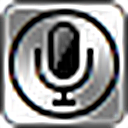
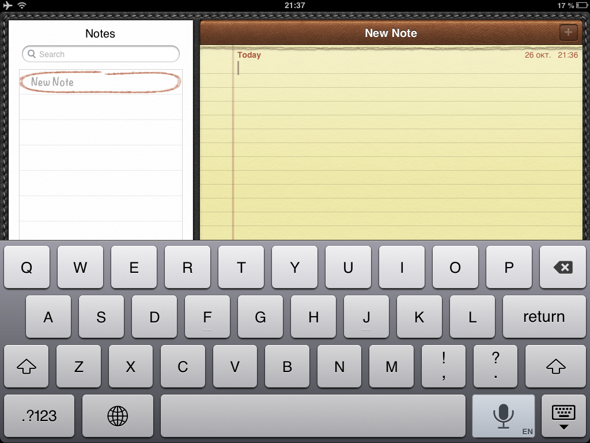
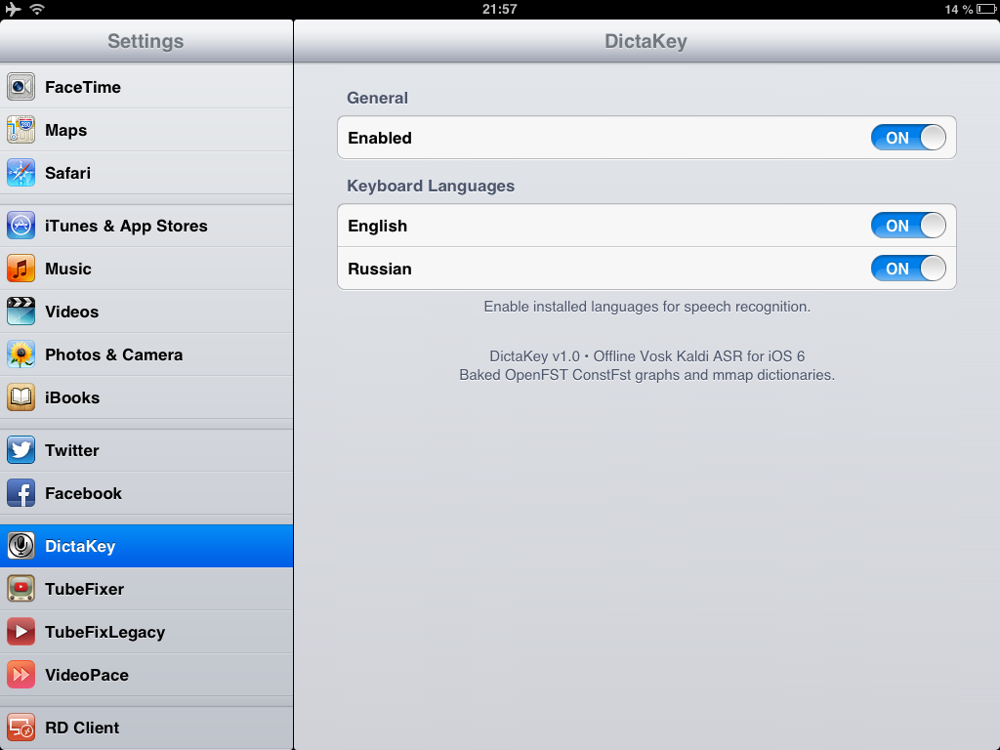

# DictaKey

<p align="center">
  <br>
  <b>Полностью оффлайн голосовая диктовка для iOS 6</b><br>
  <i>На базе Vosk Kaldi, OpenFST ConstFst и скевоморфного дизайна UIKit.</i>
</p>

<p align="center">
  <a href="https://noname122021.github.io/cydia-repo/"></a>
  
  
  
</p>

<p align="center">
  <a href="README.md"><b>English</b></a> • <a href="README.ru.md"><b>Русский</b></a>
</p>

---

## Скриншоты

| Интеграция в клавиатуру (Заметки) | Настройки и управление языками |
|:---:|:---:|
|  |  |

---

## О проекте

**DictaKey** добавляет современную, полностью автономную оффлайн диктовку на устройства Apple под управлением iOS 6 (процессоры A5/A6, 32-битная архитектура ARMv7). Твик встраивает аутентичную скевоморфную клавишу микрофона прямо в нативную клавиатуру iOS, передает звук через низколатентный кольцевой буфер в нейросетевую модель Kaldi и печатает распознанный текст в любое активное текстовое поле в реальном времени.

Для работы **не требуется интернет, внешние серверы или Siri**. Вся обработка звука и распознавание речи происходят на процессоре самого устройства.

---

## Ключевые возможности

- **Аутентичная скевоморфная клавиша диктовки**
  - Клавиша `DKButtonView` отрисована через CoreGraphics с классическими градиентами, микро-фасками и вдавленными тенями эпохи Скотта Форстолла.
  - Анимированный RMS-визуализатор волны голоса прямо внутри контура микрофона во время записи.
  - Встроена в `UIKeyboardImpl` на место правой клавиши «.?123» на iPad и iPhone.

- **Мультиязычность и отслеживание клавиатуры**
  - Автоматически следует за активным языком клавиатуры (`ru`, `en`, `uk`, `de`, `fr`, `es`, `it`).
  - При переключении раскладки модель Vosk подменяется на лету.

- **Голосовая пунктуация**
  - Распознавание знаков препинания голосом для 7 языков:
    - **Русский (RU):** `запятая` $\to$ `,`, `двоеточие` $\to$ `:`, `тире` $\to$ ` —`, `дефис` $\to$ `-`.
    - **English (EN):** `comma` $\to$ `,`, `period` $\to$ `.`, `colon` $\to$ `:`, `dash` $\to$ ` —`, `hyphen` $\to$ `-`, `exclamation` $\to$ `!`, `question` $\to$ `?`.
    - **Українська (UK):** `кома` $\to$ `,`, `двокрапка` $\to$ `:`, `тире` $\to$ ` —`, `дефіс` $\to$ `-`.
    - **Немецкий, Французский, Испанский, Итальянский:** полная поддержка нативных слов пунктуации.
  - Автоматическое снятие лишнего пробела перед знаком (`DeleteBack(1)`), благодаря чему запятые и точки прилипают к предыдущему слову.

- **Модульная дистрибуция через Cydia / APT**
  - Базовый твик весит всего **2.7 МБ**.
  - Тяжелые языковые модели упакованы в отдельные пакеты Cydia (`com.noname122021.dictakey-model-<lang>`).
  - Панель настроек PreferenceLoader динамически сканирует `/var/mobile/Library/vosk/` и показывает переключатели только для установленных моделей, подтягивая названия языков через системный `[NSLocale currentLocale]`.

---

## Установка через Cydia

1. Откройте **Cydia** на вашем устройстве с джейлбрейком.
2. Перейдите в **Управление** $\to$ **Источники** $\to$ **Правка** $\to$ **Добавить**.
3. Введите адрес репозитория:
   ```
   https://noname122021.github.io/cydia-repo/
   ```
   *(Или откройте этот адрес в Safari на планшете и нажмите кнопку **Add to Cydia**)*.
4. Найдите и установите твик **DictaKey**.
5. Установите необходимые языковые пакеты (например, **DictaKey Model (Russian)**).

---

## Поддерживаемые устройства

- **iPad mini 1-го поколения** (iOS 6.1.2 / 6.1.3)
- **iPad 2 / iPad 3 / iPad 4** (iOS 6.0 – 6.1.3)
- **iPhone 4S / iPhone 5** (iOS 6.0 – 6.1.4)
- **iPod touch 5-го поколения** (iOS 6.0 – 6.1.6)

---

## Архитектура и оптимизации

```
[ Микрофон устройства ] 
        │ 16 кГц Mono PCM (AudioUnit RemoteIO)
        ▼
[ Lock-Free SPSC Ring Buffer ] (4 МБ)
        │
        ▼
[ Фоновый рабочий поток Vosk Recognizer ]
   ├── Акустическая модель Kaldi nnet3 (AmNnetSimple)
   ├── Граф поиска ConstFst в mmap (0 МБ оперативной памяти кучи)
   └── Бинарная mmap-таблица символов (words.bin, O(1) поиск)
        │ События промежуточного и финального текста
        ▼
[ Нормализатор пунктуации ] (ApplyPunctuation)
        │ Удаление пробела перед знаком и подстановка символа
        ▼
[ Печать в текст: UIKeyboardImpl InsertText / DeleteFromInput ]
```

### Метрики производительности

| Параметр | Исходный Vosk | DictaKey (Оптимизированный) |
|---|---|---|
| **Холодный запуск модели** | 6.8 секунд | **2.1 секунды** (Параллельная загрузка в pthread) |
| **Загрузка словаря слов** | 1,500 мс (words.txt) | **1 мс** (mmap `words.bin`) |
| **RAM кучи на модель** | ~110 МБ | **~25 МБ** (Страничная подкачка из flash через mmap) |
| **Потребление RAM в простое** | Постоянная аллокация | **0 МБ** (Авто-выгрузка после 120 сек простоя) |

---

## Сборка из исходников

### Требования
- macOS или Linux с установленным [Theos](https://theos.dev)
- iOS 6.1 SDK в `$THEOS/sdks/`
- Clang cross-компилятор под целевую архитектуру `armv7`

### Сборка базового твика
```bash
cd tweak
THEOS=~/theos make TARGET_SWIFTC=false package FINALPACKAGE=1 DEBUG=0
```
Собранный пакет появится в `tweak/packages/com.noname122021.dictakey_1.0.0_iphoneos-arm.deb`.

### Запекание новых языков
Инструкции по конвертации моделей Vosk в оптимизированные mmap-графы находятся в [baking/README.md](baking/README.md).

---

## Благодарности

- **[Kaldi ASR](https://github.com/kaldi-asr/kaldi)** ([Daniel Povey](https://github.com/danpovey) и команда Kaldi) — за алгоритмы декодирования речи и FST-графы.
- **[Vosk API](https://github.com/alphacep/vosk-api)** ([Николай Шмырев](https://github.com/nshmyrev) / [Alpha Cephei](https://alphacephei.com/)) — за библиотеку легковесного распознавания речи и предобученные акустические модели.
- **[invoxiplaygames](https://github.com/invoxiplaygames)** — за фиксы корневых сертификатов TLS, поддержку старых версий iOS и инфраструктуру сообщества Cydia.
- **[Jay Freeman (saurik)](https://github.com/saurik)** — за создание [Cydia](https://github.com/saurik/cydia), [MobileSubstrate](https://github.com/saurik/cydia-substrate) и экосистему джейлбрейка iOS.
- **[Theos](https://github.com/theos/theos)** — за современный кроссплатформенный тулчейн разработки твиков.

---

## Лицензия

- Твик DictaKey и модификации: MIT License.
- Движок Vosk: Apache License 2.0 (Alpha Cephei Inc.).
- Kaldi ASR: Apache License 2.0.
